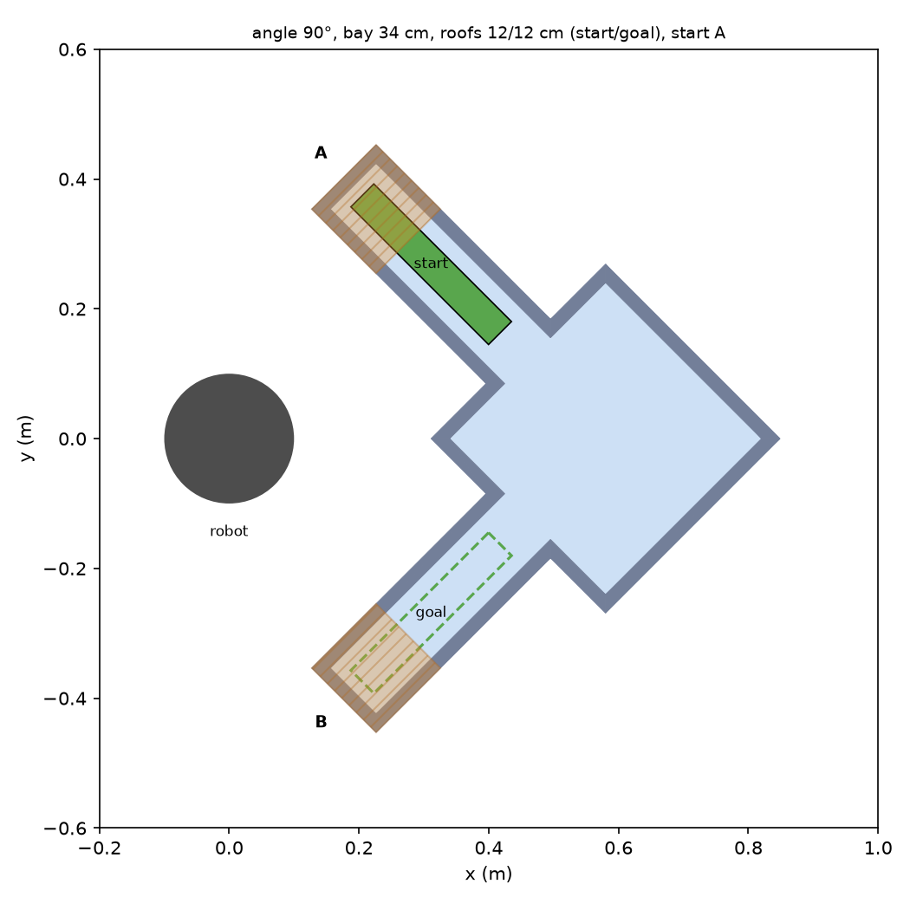

# Regrasping through a maze — environment

Drake environment for the 6.4212 project: carry a 30 × 5 × 5 cm block from a
start pocket to a goal pocket through corridors that are too narrow to turn in,
regrasping in the square "bay" at the corner. **This stage is geometry only (no robot yet).**



## Setup (once)

From this folder (`environment/` in the repo):

```bash
uv venv .venv --python 3.13          # or: python3.13 -m venv .venv
source .venv/bin/activate
uv pip install -r requirements.txt   # or: pip install -r requirements.txt
```

## Run

From this folder, with the venv activated (`source .venv/bin/activate`):

```bash
python show_in_meshcat.py            # 3D viewer: open the printed localhost URL
python show_in_meshcat.py --seed 7   # a randomized environment
python plot_top_down.py              # top-down picture -> top_down.png
python plot_top_down.py --gallery --out top_down_gallery.png   # 9 random ones
```

`show_in_meshcat.py` also simulates 2 s of gravity and prints how far the block
moved. It should be 0.00 mm. A big jump would mean the block started inside a wall.

## Files (read in this order)

| File | What it does |
|---|---|
| `environment_params.py` | **Every number** (block, corridors, bay, walls, roofs, placement) in one dataclass, plus `sample_random_params(seed)` for randomized environments. |
| `maze_layout.py` | Turns the params into a 2D floor plan of named shapes: open areas, walls, roofs, block start/goal. No Drake here. |
| `drake_environment.py` | `add_environment_to_plant(plant, layout)`: adds the floor plan to a Drake `MultibodyPlant` as 3D collision + visual geometry. |
| `show_in_meshcat.py` | Opens the environment in Drake's 3D viewer. |
| `plot_top_down.py` | Draws the floor plan from above, like the proposal figures. |

## Using it from robot / planning code

```python
from pydrake.all import AddMultibodyPlantSceneGraph, DiagramBuilder
from environment_params import EnvironmentParams
from maze_layout import make_two_segment_layout
from drake_environment import add_environment_to_plant

builder = DiagramBuilder()
plant, scene_graph = AddMultibodyPlantSceneGraph(builder, time_step=0.001)
env = add_environment_to_plant(plant, make_two_segment_layout(EnvironmentParams()))
# ... add the iiwa + gripper to the same plant here ...
plant.Finalize()

env.block                  # the block's RigidBody (a free body)
env.block_start_pose       # RigidTransform, block pose in world at the start
env.block_goal_pose        # RigidTransform, block pose in world at the goal
env.layout.open_space      # 2D shapely polygon of where the block may go
env.layout.corridor_heading  # {"A": angle, "B": angle}, from bay center toward each dead end
```

## How the geometry is built

1. **Open areas.** The bay is a square. Each corridor is a rectangle running from the
   bay center out to its dead end. Together they are "where the block may be".
2. **Walls** are generated automatically: grow the open area outward by the wall
   thickness, subtract the open area, and what's left is a wall ring 2 cm thick.
   Drake collision shapes must be convex, so the ring is cut into triangles. Each
   triangle becomes a 3-sided prism. This works for any corner angle and any number
   of corridors, so composed mazes (proposal Fig 2) can reuse it.
3. **Roofs** over the dead ends of both the start and the goal corridor, resting on
   the wall tops, so the gripper can't reach the covered part of the block when
   picking it up or setting it down.
4. **Block** is a free body lying in the start pocket. A see-through green "ghost"
   shows the goal.

World frame: the iiwa base will sit at the origin (dark disk), and the floor top is z = 0.
Both corridors open back toward the robot.

## Randomized variables (proposal §Experimental Setup)

| Variable | Range |
|---|---|
| Start roof length | 0 to 22 cm (always leaves ≥ 10 cm of block uncovered so a grasp exists) |
| Goal roof length | 0 to 22 cm, drawn separately from the start roof (same limit) |
| Bay size | 30–42 cm |
| Corner angle | 60–150° (below ~60° the two corridors start to merge) |
| Start corridor | A or B |

## Assumptions to check as a team

- **Corridor width = 10 cm**, not "barely wider than 5 cm". A top-down pinch puts the
  two WSG fingers (1.2 cm thick each) *beside* the block inside the corridor, so about
  9 cm is the minimum. The block still can't rotate more than ~10° in a corridor.
- **Wall height = 8 cm.** The gripper's palm (14.6 cm across) is wider than the
  corridor, so it must stay above the walls while the 8.2 cm fingers reach down.
- **The height limit is a rule, not an object.** `max_block_lift = 2 cm` (block bottom
  above the floor) is stored in the params for the planner to enforce. Nothing in
  the scene blocks it.
- **Where the robot base goes.** This environment assumes the iiwa base at the world
  origin. Hailey's `scene/scene.py` welds it at (0, −0.5, 0), rotated 180°. Pick one
  convention before combining them.
- **Reachability is untested.** The bay center is at x = 0.58 m. Its far corner can
  be ~0.88 m from the base, which may be past what the iiwa can reach top-down. Move it
  with `bay_center_xy` if the week-1 reachability test says so.
- **Contact model:** hydroelastic (slightly soft block, rigid scenery), so flat faces
  touch over a patch instead of at a point.
